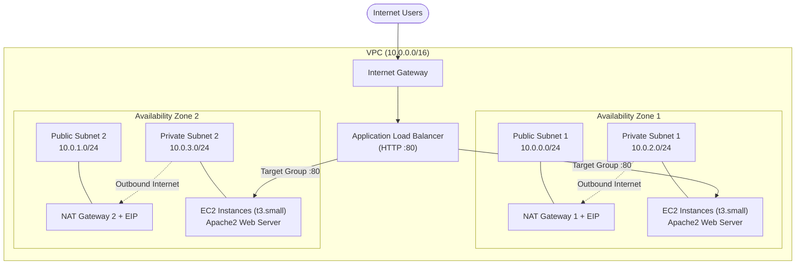

# Deploy a High-Availability Web App Using AWS CloudFormation

Infrastructure-as-Code (IaC) templates and helper scripts to provision a fault-tolerant, multi-AZ web application architecture on AWS using **AWS CloudFormation**.

The infrastructure is split into two modular CloudFormation stacks:
1. **Network Stack (`Network.yml`)** — Multi-AZ VPC (`10.0.0.0/16`) with public and private subnets across 2 Availability Zones, an Internet Gateway, and per-AZ NAT Gateways.
2. **Compute & Load Balancing Stack (`Server.yml`)** — An Application Load Balancer (ALB) in the public subnets routing HTTP traffic to an Auto Scaling Group (`MinSize: 3`, `MaxSize: 5`) of Apache2 `t3.small` instances running in the private subnets.

---

## Architecture Diagram



---

## Repository Structure

| File | Purpose |
| :--- | :--- |
| `Network.yml` | CloudFormation template for VPC, subnets, IGW, NAT Gateways, and route tables |
| `NetWorkPara.json` | Parameter values for the network stack (`EnvironmentName: UdacityProject`, CIDRs) |
| `StartNet.sh` | CLI script to deploy `Stack1` (`Network.yml`) in `us-east-1` |
| `Server.yml` | CloudFormation template for Security Groups, ALB, Target Group, Launch Config, and Auto Scaling Group |
| `ServerPara.json` | Parameter values for the compute stack (`EnvironmentName: UdacityProject`) |
| `StartSer.sh` | CLI script to deploy `Stack3` (`Server.yml`) in `us-east-1` |
| `Pics/` | Architecture diagram and AWS console verification screenshots |

---

## Deployment

### Prerequisites
- [AWS CLI](https://aws.amazon.com/cli/) configured with permissions for EC2, VPC, ELBv2, Auto Scaling, and CloudFormation.
- Default region: `us-east-1` (configured in `StartNet.sh` and `StartSer.sh`).

### 1. Deploy the Network Stack
```bash
chmod +x StartNet.sh
./StartNet.sh
```
Wait for `Stack1` to reach `CREATE_COMPLETE`:
```bash
aws cloudformation wait stack-create-complete --stack-name Stack1 --region us-east-1
```

### 2. Deploy the Server & Load Balancer Stack
```bash
chmod +x StartSer.sh
./StartSer.sh
```

### 3. Get the Load Balancer URL
```bash
aws cloudformation describe-stacks \
  --stack-name Stack3 \
  --region us-east-1 \
  --query "Stacks[0].Outputs[?OutputKey=='LoadBalancerUrl'].OutputValue" \
  --output text
```

### Cleanup
Delete the compute stack first (since it imports exports from the network stack), then delete the network stack:
```bash
aws cloudformation delete-stack --stack-name Stack3 --region us-east-1
aws cloudformation wait stack-delete-complete --stack-name Stack3 --region us-east-1
aws cloudformation delete-stack --stack-name Stack1 --region us-east-1
```
